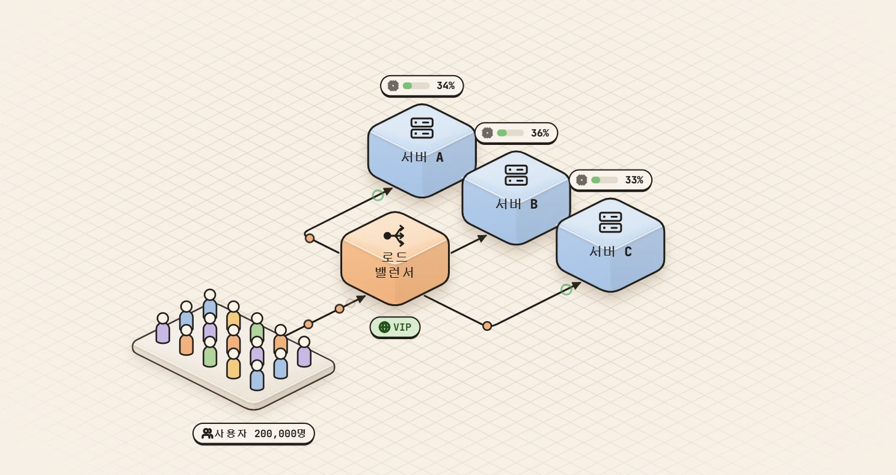
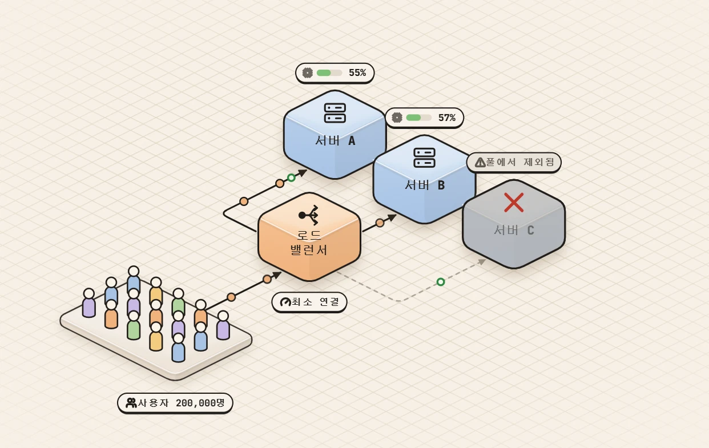
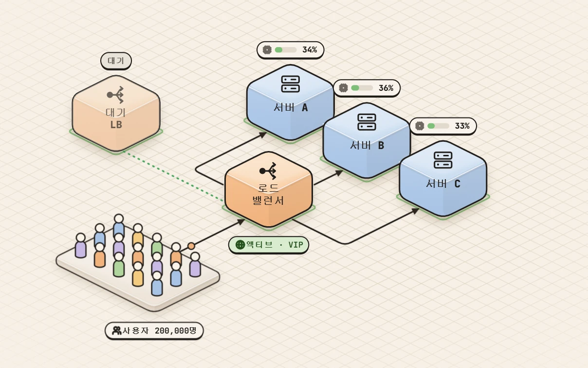

# cwebd — Reverse Proxy 웹 서버

C로 만든 HTTP 서버이고, **Reverse Proxy**를 구현했습니다.
Reverse Proxy는 서버 앞에서 손님의 요청을 대신 받아, 뒤에 있는 여러 서버에 나눠 전달합니다.
경로 규칙(`/api` 등)으로 백엔드를 고르고, Round-Robin으로 번갈아 보내며, 서버 하나가 죽으면 다른 서버로 넘깁니다.
정적 파일은 프록시가 직접 응답합니다.

## 구조

## 사용목적

### 왜 쓰나

- **로드 밸런싱**: 요청을 여러 서버에 나눠서 한 대에 몰리지 않게 합니다.
- **보안**: 뒤의 서버는 숨기고, 앞문 하나만 지킵니다.
- **경로 라우팅**: `/api`는 서버 A, `/images`는 서버 B처럼 기능별로 나눕니다.

### 전부 동적으로 만들면 안 되나?

| | 정적 | 동적 |
|---|---|---|
| 예 | `GET /images/a.png` (저장된 파일 그대로) | `GET /api/orders` (요청마다 DB를 조회해 계산) |
| 하는 일 | 파일을 읽어 그대로 보냄 | 코드 실행, DB 조회 |
| 비용 | 낮음 | 높음 |
| 캐싱 | 쉬움 (누구에게나 같은 내용) | 어려움 (사람마다 다름) |

가능은 하지만, 이미지 하나에 코드와 DB까지 쓰면 낭비라서 가벼운 정적은 따로 처리합니다.
비용 = 서버가 쓰는 자원(CPU 시간, 메모리, DB 조회). 많이 쓸수록 서버를 더 늘려야 해서 결국 돈으로 이어집니다.

### 서버가 다운되면

- 연결이 안 되는 서버는 건너뛰고 다음 서버로 넘깁니다(failover). 손님은 에러를 보지 않습니다.
- 모든 서버가 다운되면 `502`, 응답이 없으면 `504`를 돌려줍니다.

**추가되는 점**: 몇 초마다 서버가 살아 있는지 확인하는 헬스 체크를 넣어, 죽은 서버를 미리 풀에서 제외합니다.

### 리버스 프록시(로드밸런서)가 다운되면

- 프록시가 하나뿐이면 뒤의 서버가 멀쩡해도 서비스 전체가 멈춥니다(단일 장애점).
- 실제 서비스는 프록시도 2대 이상으로 이중화합니다. 이 프로젝트는 한 대라서 한계입니다.

**추가되는 점**: 프록시 2대를 가상 IP(VIP)로 묶어, 주 프록시가 죽으면 대기 프록시가 같은 주소를 이어받게 합니다.

## 검증

### 테스트 4종

| 종류 | 무엇을 | 결과 |
|---|---|---|
| 단위 | 부품 하나씩 (HTTP 파서, 라우터, MIME, 경로 처리) | 177개 통과 |
| 통합 | 진짜 서버와 백엔드 2대에 curl로 요청 | 52개 통과 |
| 메모리 | ASan, UBSan으로 오류와 누수 검사 | 오류 없음 |
| 부하 | `wrk`, `ab`로 동시 접속 | 소켓 오류 0 |

### 테스트가 잡은 버그 2건

| 발견한 테스트 | 증상 | 원인 | 수정 |
|---|---|---|---|
| 통합 | 프록시 요청 13개가 전부 `504` | 백엔드로 보내는 요청 끝의 빈 줄을 길이를 잘못 세어 빠뜨림. 백엔드가 요청이 끝난 줄 모름 | 길이를 직접 세지 않고 자동 계산으로 변경 |
| 부하 | 동시 200에서 연결 64개 타임아웃 | keep-alive 연결이 워커를 붙잡아 일부 연결이 굶음 | 대기 중인 연결이 있으면 keep-alive를 끊음 |
