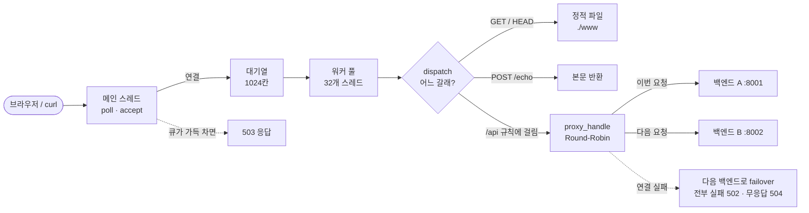

# cwebd — C로 밑바닥부터 만든 웹 서버 + Reverse Proxy

외부 HTTP 라이브러리 없이 **POSIX 소켓 API만으로** 만든 HTTP/1.1 서버입니다.
정적 파일 서빙, 동적 요청 처리(`POST /echo`), 경로 기반 **Reverse Proxy**(Round-Robin, failover)를 지원합니다.

| 한눈에 보기 | |
|---|---|
| 언어 / 의존성 | C11, 표준 라이브러리 + POSIX (`libevent`, `nginx` 등 미사용) |
| 동시성 | 스레드 풀 (워커 32개, 대기열 1024칸) |
| 검증 | 단위 테스트 177개 · 통합 테스트 52개 · ASan/UBSan 무오류 · `wrk`/`ab` 부하 테스트 |

## 1. 아키텍처



- **메인 스레드**는 연결을 받아 큐에 넣기만 합니다(요청 내용은 읽지 않음).
- **워커**가 큐에서 연결 하나를 꺼내 끝까지 처리합니다: 읽기 → 파싱 → `dispatch` → 응답.
- `dispatch`는 **프록시 규칙을 먼저** 검사합니다. 정적 파일 갈래가 모든 `GET`을 받기 때문에, 구체적인 규칙이 먼저여야 합니다.

## 2. 설계 배경: 계층과 패킷

웹 서버가 네트워크 계층 구조의 **어디를 직접 구현하고 어디를 운영체제에 맡기는지**가 이 프로젝트의 설계 출발점입니다.

| OSI 7계층 | TCP/IP 4계층 | 누가 담당? | 이 프로젝트에서 |
|---|---|---|---|
| 응용 · 표현 · 세션 | **응용** | **우리 코드** | HTTP 파서/응답 생성 (`http.c`), 정적 파일, 프록시 |
| 전송 | **전송** (TCP) | 운영체제 | 3-way handshake, 순서 보장, 재전송, 패킷 쪼개기 |
| 네트워크 | **인터넷** (IP) | 운영체제 | 주소(`127.0.0.1`) 기반 경로 선택 |
| 데이터링크 · 물리 | **네트워크 접근** | 하드웨어 · 드라이버 | 이더넷 / Wi-Fi 신호 전송 |

**소켓 API(`socket · bind · listen · accept · recv · send`)가 응용 계층과 전송 계층 사이의 경계**입니다.
`socket(AF_INET, SOCK_STREAM, 0)`의 `SOCK_STREAM`이 "전송 계층은 TCP를 쓴다"는 선언입니다.

**이론이 코드의 설계 결정으로 이어진 지점**

| 네트워크 사실 | 그래서 우리 코드는 |
|---|---|
| 데이터는 **캡슐화**되어 패킷으로 쪼개져 오므로, 요청이 한 번에 안 올 수 있다 | `recv`를 반복하고, 요청이 완성될 때까지 파서가 `INCOMPLETE`를 돌려준다 (`handle_conn`) |
| TCP는 **메시지 경계가 없는 바이트 스트림**이다 | 본문의 끝을 `Content-Length`로만 판단한다. 모호하면(`CL` 중복, `CL`+`TE`) `400`으로 거부 |
| `send`는 **일부만 보내고 돌아올 수 있다** | `net_send_all`이 끝까지 반복한다 |
| 연결은 **운영체제가 handshake로 완성**하고 `accept`는 꺼내 오기만 한다 | 대기용 소켓과 연결 소켓을 구분하고, 연결은 큐로 워커에게 넘긴다 |
| 상대가 **언제든 느려지거나 사라질 수 있다** | 모든 대기에 제한 시간: idle 5초, 요청 전체 15초, 백엔드 연결 3초, 백엔드 응답 10초 |

## 3. 데모 시나리오 (약 1분 15초)

터미널 두 개를 씁니다. (Linux / macOS / WSL2)

```sh
# 준비: 백엔드 2대 + 서버
python3 tests/backend.py 8001 A &
python3 tests/backend.py 8002 B &
make && build/webserver -p 8080 -r ./www -R /api=127.0.0.1:8001,127.0.0.1:8002
```

| # | 보여줄 것 | 명령 | 기대 결과 |
|---|---|---|---|
| 1 | 정적 파일 | `curl -i localhost:8080/` | `200 OK`, `Content-Type: text/html` |
| 2 | **Round-Robin** | `for i in 1 2 3 4; do curl -s localhost:8080/api/x; done` | `backend A`, `backend B`가 번갈아 나옴 |
| 3 | **failover** | 백엔드 B 종료 후 같은 명령 반복 | 에러 없이 전부 `backend A`로 응답 |
| 4 | 경로 탈출 차단 | `curl -i --path-as-is localhost:8080/../etc/passwd` | `403 Forbidden` |
| 5 | 잘못된 요청 | `printf 'GARBAGE\r\n\r\n' \| nc localhost 8080` | `400 Bad Request` |
| 6 | 서버 로그 | 서버 터미널 | `IP "GET /" 200 646` 같은 액세스 로그 |

## 4. 검증: 테스트와 결과

AI로 구현한 코드를 그대로 믿지 않고, **테스트를 먼저 만들고 통과를 확인**했습니다.

```sh
make test         # 단위 테스트 177개
make test-asan    # 같은 테스트를 AddressSanitizer + UBSan(+LeakSanitizer)으로
make itest        # 통합 테스트 52개 (실제 서버 + 백엔드 2대 + curl / raw TCP)
bash tests/bench.sh build/webserver   # wrk / ab 부하 테스트
```

| 종류 | 대상 | 규모 | 결과 |
|---|---|---|---|
| 단위 | HTTP 파서(엣지 케이스), MIME, 라우터·설정, 정적 경로 해석·서빙 | 4개 파일, 177개 검사 | 모두 통과 |
| 통합 | 정적 응답, 405/413, 잘못된 요청(400/414/431/501/505), keep-alive, pipelining, 프록시(Round-Robin·failover·502·504·chunked), 동시 300/200 요청, SIGTERM 종료 | 52개 검사 | 모두 통과 |
| 메모리 | ASan + UBSan + LeakSanitizer로 단위·통합 테스트 | — | 오류·누수 없음 |
| 부하 | `wrk`, `ab` | 아래 표 | 소켓 오류 0 |

### 테스트가 실제로 잡은 문제

| 발견한 곳 | 증상 | 원인 | 수정 후 |
|---|---|---|---|
| 통합 테스트 | 프록시 관련 검사 13개가 전부 `504`로 실패 | 백엔드로 보내는 요청 끝(`Connection: close\r\n\r\n`)의 길이를 잘못 세어 마지막 2바이트가 잘림 → 백엔드가 요청이 끝났는지 알 수 없음 | 52개 모두 통과 |
| 부하 테스트 (동시 200, 워커 64) | 연결 64개가 타임아웃 | keep-alive 연결이 워커를 붙잡아, 연결 수가 워커 수를 넘으면 일부가 굶음 | 대기 중인 연결이 있으면 keep-alive를 끊도록 변경, 소켓 오류 0 |

※ 두 번째 항목은 수정과 함께 정적 루트를 WSL 내부 파일시스템으로 옮겨 다시 측정했습니다.

### 부하 테스트 결과

WSL2 Ubuntu, 같은 머신에서 `wrk`/`ab`를 실행한 값이라 절대 수치보다 경향을 보세요.
정적 루트는 WSL 내부 파일시스템입니다. (`/mnt/c` 위에서는 `realpath/stat`이 느려 약 2k req/s까지 떨어졌습니다.)

| 시나리오 | 결과 |
|---|---|
| 정적 파일, keep-alive, 동시 50 | 약 42,600 req/s, 평균 4.0 ms |
| 정적 파일, keep-alive, 동시 200 (워커 64개) | 약 48,000 req/s, 소켓 오류 0 |
| `ab` keep-alive 없음, 동시 100, 20,000건 | 약 13,200 req/s, 실패 0 |
| Reverse Proxy → Python `http.server` 2대, 동시 50 | 약 1,800 req/s (병목은 Python 백엔드) |

## 5. 한계와 다음 단계

- 구현하지 않은 것: TLS, HTTP/2, 요청 본문 chunked, Range, 캐싱 헤더, gzip, Forward Proxy(`CONNECT` 포함), CGI, 백엔드 헬스체크
- 스레드 풀은 이식성과 단순함을 택한 대신, 연결 수가 매우 많은 C10K 규모에서는 이벤트 루프(`epoll`/`kqueue`)가 유리합니다. 다음 단계 후보입니다.
- IPv4 리슨만 지원하고, 백엔드 연결은 요청마다 새로 맺습니다.
- macOS는 코드상 분기(`MSG_NOSIGNAL`, `SO_NOSIGPIPE`)만 처리했고 실제로 빌드해 보지는 않았습니다.

---

# 상세 문서

## 빌드와 실행

Linux / macOS / WSL2 (gcc 또는 clang, make).

```sh
make                       # build/webserver
build/webserver -p 8080 -r ./www -R /api=127.0.0.1:8001,127.0.0.1:8002
build/webserver -c routes.conf
```

| 옵션 | 의미 |
|---|---|
| `-p PORT` | 포트 (기본 8080) |
| `-r DIR` | 정적 파일 루트 (기본 `./www`) |
| `-w N` | 워커 스레드 수 (기본 32) |
| `-t SEC` | 백엔드 응답 타임아웃 (기본 10) |
| `-R /prefix=host:port[,host:port...]` | 해당 경로를 백엔드들로 전달 (반복 가능) |
| `-c FILE` | 설정 파일 (`port`/`root`/`threads`/`queue`/`timeout`/`route`, 예: `routes.conf`) |
| `-q` | 액세스 로그 끄기 |

라우팅은 **가장 긴 prefix**가 우선입니다. `/api`는 `/api`, `/api/x`와 매칭되고 `/apix`와는 매칭되지 않습니다.
백엔드가 여러 개면 요청마다 번갈아 선택하고, 연결에 실패하면 다음 백엔드로 넘어갑니다.
전부 실패하면 `502`, 연결/응답 타임아웃이면 `504`를 반환합니다.

## 소스 구조

| 파일 | 역할 |
|---|---|
| `src/server.c` | `socket/bind/listen/accept`, 스레드 풀, keep-alive 루프, 시그널 종료 |
| `src/http.c` | 요청 파서(요청 라인/헤더/`Content-Length`), 응답 생성 |
| `src/static.c`, `src/mime.c` | 정적 파일(경로 탈출/심볼릭 링크 차단), MIME 매핑 |
| `src/router.c`, `src/proxy.c` | prefix 라우팅, Round-Robin, 요청 중계, hop-by-hop 헤더 제거, `X-Forwarded-*` |
| `src/config.c`, `src/net.c`, `src/main.c` | 설정, 소켓 유틸(타임아웃 connect/recv), CLI |
| `tests/` | 단위 테스트 4개, `integration.sh`, `backend.py`, `bench.sh` |

## 설계 선택

- **동시성: 스레드 풀 + blocking I/O.** 이벤트 루프(epoll/kqueue)는 C10K에는 유리하지만 프록시까지 non-blocking 상태기계로 짜야 하고 epoll은 macOS에서 동작하지 않습니다.
  스레드 풀은 이식성이 좋고 코드가 단순합니다.
  - 대가: keep-alive 연결 하나가 워커 하나를 점유합니다. 대기 중인 연결이 있으면 keep-alive를 끊어 기아(starvation)를 막고, 큐가 가득 차면 `503`으로 부하를 차단합니다.
- **본문 경계**: `Content-Length`로만 판단합니다. `Transfer-Encoding`을 요청에서 받으면 `501`, 둘이 함께 오면 `400`입니다(request smuggling 방지).
- **프록시 응답**: `Content-Length`가 있으면 정확히 그 길이만 중계하며 keep-alive를 유지합니다. chunked/close-delimited 응답은 원본 그대로 중계하고 클라이언트 연결은 닫습니다.
- **Slowloris 대응**: 헤더+본문 전체 15초 deadline, idle keep-alive 5초.
- **종료**: `SIGINT/SIGTERM`이면 accept를 멈추고 진행 중인 요청을 마친 뒤 종료합니다. `SIGPIPE`는 무시합니다.
- **에러 응답 후 close**: 클라이언트가 계속 보내는 중에 close하면 RST로 응답이 사라지므로 half-close 후 잠깐 drain합니다.

## Proxy vs Reverse Proxy

- **Forward Proxy**는 *클라이언트*를 대신합니다(클라이언트 → Proxy → 임의의 원 서버). 접근 제어, 캐싱, 익명화에 씁니다.
- **Reverse Proxy**는 *서버*를 대신합니다(클라이언트 → Proxy → 내부 백엔드 N개). 로드 밸런싱, 백엔드 은닉, 경로별 라우팅에 씁니다. **이 프로젝트는 이쪽을 구현합니다.**
