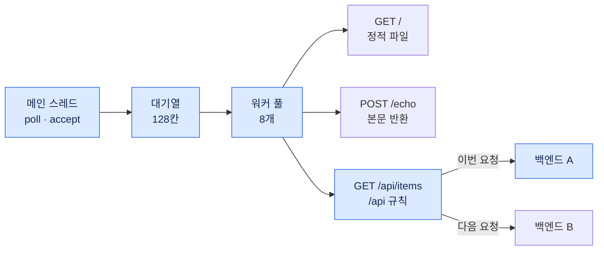

# 워커 8개가 모두 바쁘면, 아홉 번째 요청은 어떻게 될까?

**Jungle Web Server** · 외부 HTTP 라이브러리 없이 C11과 POSIX 소켓으로 만든 웹 서버·리버스 프록시

## 1. 요청 하나가 백엔드에 도착하기까지



TCP에서는 헤더가 여러 번에 나뉘어 도착할 수 있다. 워커는 빈 줄까지 읽어 헤더의 끝을 찾고, `/api/items`와 일치하는 경로 규칙을 고른다. 같은 규칙의 백엔드는 **라운드 로빈**으로 선택한다.

## 2. 느린 백엔드가 정적 파일 요청까지 기다리게 한다

**고정 스레드 풀**은 요청마다 새 스레드를 만드는 비용을 줄이고, 동시에 일하는 워커 수를 8개로 제한한다. 정적 파일과 프록시 요청은 이 워커를 공유한다.


| 새 연결이 들어온 순간 | 서버의 동작 |
| --- | --- |
| 워커 8개가 모두 백엔드 응답 대기 중 | 아홉 번째 연결은 큐에서 기다린다. **작은 HTML 파일을 요청해도 마찬가지다.** |
| 워커 8개가 계속 바쁘고 대기열 128칸도 가득 참 | 메인 스레드가 새 연결에 `503 Service Unavailable` 전송을 시도하고 닫는다. |

대기열은 순간적으로 몰린 연결을 받아 준다. 128칸의 상한은 서버가 대기 연결을 위해 열어 둘 소켓 수를 제한한다.

## 3. 4초 뒤에 데이터가 오면 1초가 남는다

```text
0초                       4초                   5초
워커가 요청을 읽기 시작 ──── 데이터 추가 도착 ───── 수신 마감
                          └── 남은 시간 1초 ────┘
```

워커가 읽기 시작할 때 `CLOCK_MONOTONIC`으로 마감 시각을 정한다. 데이터가 더 도착해도 마감 시각은 그대로이고, `poll()`에는 남은 시간만 넘긴다. **큐 대기는 요청 수신 5초에 포함되지 않는다.**

| 워커가 기다리는 구간 | 마감 시간 | 만료 시 동작 |
| --- | --- | --- |
| 클라이언트 요청 수신 | 헤더와 본문을 합쳐 5초 | `408 Request Timeout` |
| 백엔드 연결 | 최대 2초 | `504 Gateway Timeout` |
| 연결 후 백엔드 요청 송신·응답 수신 | 두 작업을 합쳐 5초 | 클라이언트 응답을 시작하기 전이면 `504`. 이미 중계 중이면 연결 종료 |

## 4. 기다리는 도중에도 서버는 정리되는가?

| 통합 테스트에서 만든 상황 | 확인한 결과 |
| --- | --- |
| 테스트 전용 경로 `/slow`의 백엔드가 연결만 받고 응답하지 않는다. | 클라이언트가 **`504`** 수신 |
| `POST /echo`의 본문을 기다리는 중에 `SIGTERM`을 보낸다. | 서버 프로세스가 **2초 이내 정상 종료** |

종료 신호를 받으면 시그널 핸들러가 파이프에 1바이트를 쓴다. 메인 스레드의 `poll()`이 깨어나면 서버는 새 연결 수락을 멈추고, 대기 연결과 처리 중인 연결을 정리한 뒤 워커 종료를 기다린다. [통합 테스트](tests/integration.py) · [종료 처리](src/server.c)

**정적 파일 부하 측정** · macOS ARM64 루프백에서 `GET /` 2,000건, 동시성 64로 **43,685 req/s · 실패 0건**

**메모리 검사** · ASan·UBSan 통과. 정적 파일·에코·프록시 반복 호출 후 macOS `leaks` 검사에서 **누수 0건**

## 5. 아홉 번째 요청에 대한 답

**아홉 번째 요청은 큐에서 기다리다가 먼저 비는 워커로 간다.** 큐의 크기는 *얼마나 많은 연결이 기다릴지* 제한하고, 각 I/O 단계의 마감 시간은 *워커가 얼마나 오래 기다릴지* 제한한다.

현재 라운드 로빈은 응답이 없던 백엔드도 다시 선택한다. 다음 단계는 **헬스 체크**로 장애 백엔드를 잠시 제외해, 다음 워커까지 같은 곳에서 다시 5초를 기다리는 일을 줄이는 것이다.

---

<details>
<summary><strong>개발자 참고 · 빌드, 프록시 실행 예시, 테스트 및 전체 측정 결과</strong></summary>

## 빌드 및 실행

```sh
make
./webserver 8080 ./public
```

서버는 지정한 포트의 IPv4 인터페이스에서 연결을 받습니다. 디렉터리 요청은 해당 디렉터리의 `index.html`을 돌려줍니다. `POST /echo`는 요청 본문을 바이트 그대로 반환합니다.

```sh
curl -i http://127.0.0.1:8080/
curl -i --data-binary 'hello' http://127.0.0.1:8080/echo
```

## 리버스 프록시

각 인자를 `/prefix=HOST:PORT[,HOST:PORT...]` 형식으로 전달합니다. 경로 세그먼트를 기준으로 일치하는 가장 긴 접두사를 찾고, 같은 규칙의 백엔드는 라운드 로빈으로 선택합니다. 예를 들어 `/api`는 `/api/items`와 일치하고 `/apix`는 정적 파일 처리로 넘어갑니다. 백엔드에는 원래 요청 경로와 쿼리를 전달합니다.

두 백엔드를 실행합니다. 같은 작업 디렉터리에서 세 번째 터미널로 웹 서버를 실행하기 전에 앞의 정적 파일 서버를 종료해 포트를 비워 둡니다.

```sh
# 터미널 1
backend_a=$(mktemp -d)
mkdir "$backend_a/api"
printf 'backend A\n' > "$backend_a/api/items"
python3 -m http.server 8001 --bind 127.0.0.1 --directory "$backend_a"
```

```sh
# 터미널 2
backend_b=$(mktemp -d)
mkdir "$backend_b/api"
printf 'backend B\n' > "$backend_b/api/items"
python3 -m http.server 8002 --bind 127.0.0.1 --directory "$backend_b"
```

```sh
# 터미널 3
./webserver 8080 ./public '/api=127.0.0.1:8001,127.0.0.1:8002'
```

```sh
# 터미널 4
curl -fsS http://127.0.0.1:8080/api/items  # backend A
curl -fsS http://127.0.0.1:8080/api/items  # backend B
curl -fsS http://127.0.0.1:8080/          # 로컬 index.html
```

## 동작 범위

- `socket → bind → listen → accept` 흐름으로 리스너를 만들고 `SO_REUSEADDR`을 설정합니다. 메인 스레드는 `poll`로 리스너와 종료 신호를 기다리며, 워커 8개가 최대 128개의 대기 연결을 처리합니다. 백엔드가 느리면 워커 하나를 점유하며 대기열이 가득 차면 `503`을 반환합니다.
- `GET`과 `POST`의 HTTP/1.0·1.1 요청을 지원합니다. 요청 라인과 헤더는 CRLF로 구분하고, 본문은 `Content-Length`로 읽습니다. 요청 URI 2 KiB, 헤더 영역 16 KiB, 헤더 100개, 본문 1 MiB를 상한으로 둡니다. 요청의 `Transfer-Encoding`에는 `501`을 반환합니다.
- 연결당 요청 하나를 처리하고 `Connection: close`를 보냅니다. URI의 경로 부분은 퍼센트 디코딩하며, 정적 파일을 열 때 루트 디렉터리 기준으로 각 경로 요소를 확인합니다. 상위 경로 이동과 심볼릭 링크에 대한 요청은 `403`으로 처리합니다.
- 프록시는 설정된 백엔드에 새 TCP 연결을 만들고, 연결 구간에만 유효한 헤더를 제거한 뒤 요청을 전달합니다. 응답은 `Content-Length`, chunked 또는 연결 종료를 기준으로 스트리밍합니다. 응답 헤더를 보내기 전 감지한 백엔드 오류는 `502`, 타임아웃은 `504`로 처리합니다.
- 클라이언트 수신 5초, 백엔드 연결 2초, 백엔드 요청 송신 및 응답 수신 합계 5초, 클라이언트 응답 송신 15초의 제한 시간을 둡니다. `SIGINT`와 `SIGTERM`은 새 접속을 중단하고 대기 및 처리 중 연결을 정리합니다. `SIGPIPE`는 무시합니다.

HTTP 메시지 형식과 전달 규칙에 참고한 표준입니다. [RFC 9112](https://www.rfc-editor.org/rfc/rfc9112.html), [RFC 9110](https://www.rfc-editor.org/rfc/rfc9110.html)

## 테스트

```sh
make test
make sanitize
```

통합 테스트에는 Python 3과 로컬 TCP 연결이 필요합니다. 테스트는 분할 수신, 바이너리 POST, 잘못된 헤더와 본문 길이, 정적 파일 경로 및 MIME 타입, 라운드 로빈, 백엔드 응답 프레이밍, 타임아웃, 동시 접속과 `SIGTERM` 종료를 검사합니다. macOS ARM64에서 단위·통합 테스트와 AddressSanitizer·UndefinedBehaviorSanitizer를 통과했습니다. macOS `leaks`로 정적 파일, `POST /echo`, 프록시를 반복 호출한 실행 중 프로세스를 검사한 결과 누수는 0건이었습니다.

### 로컬 부하 테스트

macOS ARM64에서 루프백으로 정적 `GET /` 요청을 각 동시성 수준당 2,000회 보낸 결과입니다.

```sh
for concurrency in 1 8 32 64; do
  ab -n 2000 -c "$concurrency" -s 10 http://127.0.0.1:8080/
done
```

| 동시 접속 | 초당 요청 | 실패 요청 |
| ---: | ---: | ---: |
| 1 | 14,817 | 0 |
| 8 | 35,904 | 0 |
| 32 | 41,927 | 0 |
| 64 | 43,685 | 0 |

</details>
